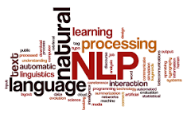
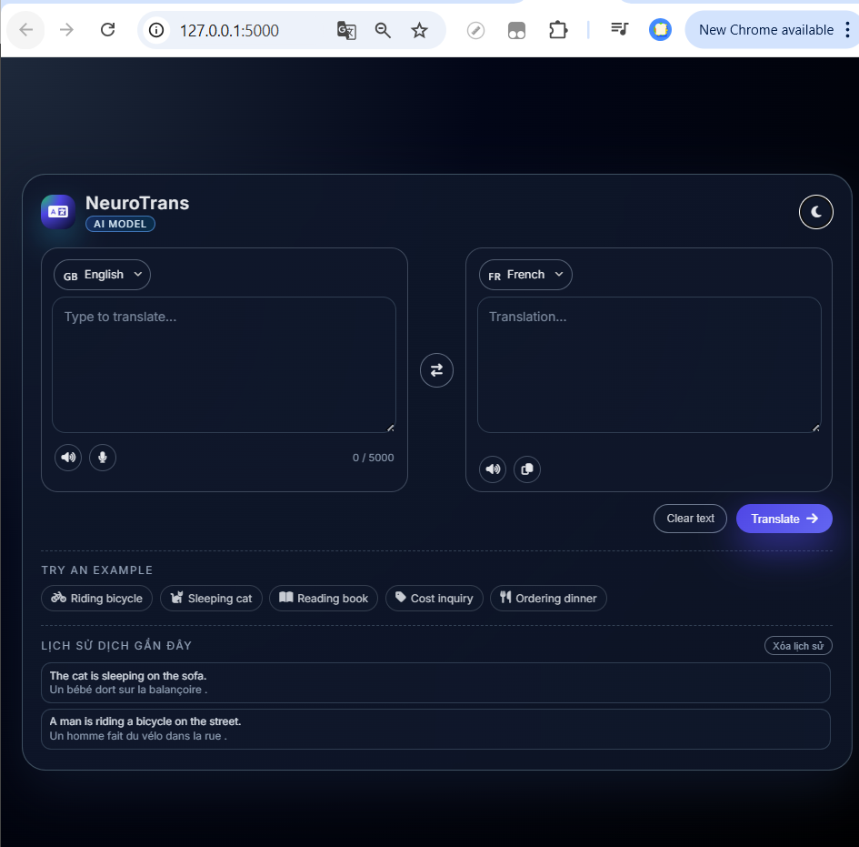
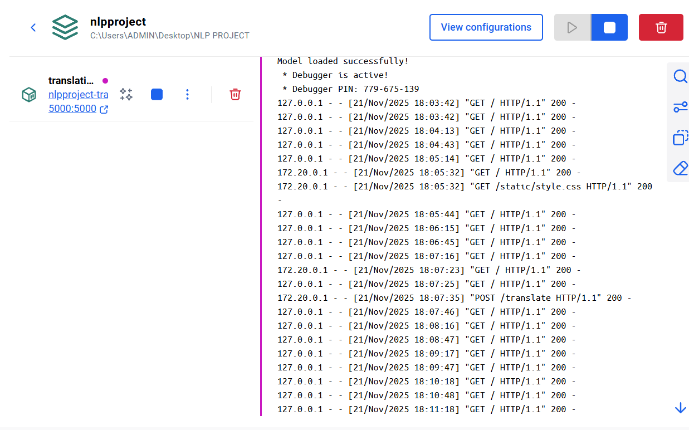

## English–French Neural Machine Translation

<p align="center">
  <table>
    <tr>
      <td align="center">
        <br>
        <b>NLP</b>
      </td>
      <td align="center">
        <br>
        <b>Machine Translation</b>
      </td>
      <td align="center">
        <br>
        <b>Logo SGU</b>
      </td>
      <td align="center">
        <br>
        <b>DOCKER</b>
      </td>
    </tr>
  </table>
</p>

Seq2Seq English–French machine translation model built with PyTorch + TorchText, featuring a complete training/evaluation pipeline, best-performing checkpoints, and a ready-to-use `translate()` function for automatic grading.


---

## 1. Key Features
- ✅ **Two-layer Encoder–Decoder LSTM** (EMB_DIM=256, HID_DIM=512) with dropout, teacher forcing, and gradient clipping for stability.
- ✅ **Standard Multi30k dataset**: spaCy tokenizer, vocab limit, DataLoader with automatic padding + sorting for `pack_padded_sequence`.
- ✅ **Utility-rich training loop**: logs loss/PPL, early stopping, saves `best_model.pth`, plots `loss_curve.png`, and computes BLEU on the test set.
- ✅ **One-line inference** via `inference.translate(sentence)` with model caching.
- ✅ **Centralized configuration** in `config.py` for easy experimentation on GPU/CPU or custom datasets.


---

## 2. Overview Architecture
### 2.1 Model
- `Encoder`: embedding + multi-layer LSTM, returning context `(hidden, cell)`.
- `Decoder`: receives the previous token (teacher forcing or model output), producing the vocabulary distribution via the final linear layer.
- `Seq2Seq`: combines encoder/decoder, initializes input `<sos>` and runs until `trg_len`.

### 2.2 Processing Flow
1. **Preprocess**: read `.en/.fr`, tokenize, add special tokens, numericalize, and store in `TranslationDataset`.
2. **Batching**: `collate_fn` pads sequences, sorts by decreasing length, and moves tensors to `config.DEVICE`.
3. **Training**: `train_eval.py` calls `train_one_epoch` + `evaluate`, applying early stopping after `EARLY_STOPPING_PATIENCE` epochs without improvement.
4. **Checkpoint & Metrics**: saves `state_dict` + vocab; BLEU computed using `nltk.translate.sentence_bleu` with smoothing method 4.


---

## 3. Dataset & Data Preparation
| Step | Description |
| --- | --- |
| 1. Download Multi30k | Clone or download Task 1 (EN↔FR) from https://github.com/multi30k/dataset. |
| 2. Extract | Place the `.gz` files into `multi30k-dataset/data/task1/raw`. |
| 3. Generate `.en/.fr` files | Run `python prepare_multi30k_en_fr_task1.py` to extract them into `data/multi30k_en_fr`. |
| 4. Adjust paths | If stored elsewhere, update `DATA_ROOT` in `config.py`. |

The script uses the Flickr 2016 test set (1k sentences). You may replace the input files as long as the sentence pairs remain aligned for the pipeline to work.


---

## 4. Environment Setup
```bash
python -m venv .venv && source .venv/bin/activate    # or conda
pip install -r requirements.txt
```
- `requirements.txt` already points to the wheels for `en_core_web_sm` and `fr_core_news_sm`. If pip does not install them automatically, run::
  ```bash
  python -m spacy download en_core_web_sm
  python -m spacy download fr_core_news_sm
  ```
- NLTK `punkt` is downloaded automatically on the first run.

---

## 5. Training & Evaluation
```bash
python train_eval.py
```
You will get:
- Device log (GPU/CPU) according to `config.DEVICE`.
- Train/validation loss and perplexity per epoch.
- `best_model.pth` saved when validation loss decreases.
- `loss_curve.png` and BLEU score on the first 100 test sentences after training

Example log:
```
===== Epoch 3/15 =====
Epoch: 03 | Time: 1m 12s
    Train Loss: 2.451 | PPL: 11.600
    Val   Loss: 2.210 | PPL: 9.116
=> Saved best_model.pth (current best model)
```

---

## 6. Inference
### 6.1 Quick CLI
```bash
python inference.py
```

### 6.2 Integrate in Code
```python
from inference import translate
print(translate("A man is riding a bicycle on the street."))
```
The `translate()` function loads the checkpoint on the first call and caches it to speed up processing for multiple sentences.. Adjust `MAX_LEN_GENERATE` in `config.py` if you want to generate longer sentences.

---

## 7. Folder Structure

| Path | Description |
|------|-------------|
| `config.py` | All hyperparameters, data paths, device settings. |
| `data.py` | spaCy tokenizer, vocab builder, `TranslationDataset`, DataLoader. |
| `model.py` | Definitions of `Encoder`, `Decoder`, `Seq2Seq`. |
| `train_eval.py` | Train/val/test loop, checkpointing, BLEU scoring, plotting. |
| `inference.py` | Load model + `translate()` function for inference/demo. |
| `prepare_multi30k_en_fr_task1.py` | Extract `.gz` Multi30k files into `.en/.fr`. |
| `data/` | Contains processed data after extraction. |
| `img/` | Images for README or documentation (`@img`). |
| `loss_curve.png`, `best_model.pth` | Artifacts generated after training. |


---

## 8. Customization & Configuration
- **Hyperparameters**: modify directly in `config.py` (embedding size, hidden size, dropout, learning rate, batch size, teacher forcing ratio, gradient clipping, etc.).
- **Vocabulary**: increase `MAX_VOCAB_SIZE` if you have more resources, but always keep `SPECIAL_TOKENS`.
- **Device**: force GPU with `DEVICE = torch.device("cuda")` or let the script auto-detect.
- **New dataset**: update `DATA_ROOT`, keeping `.en/.fr` format for train/val/test.


---

## 9. Output Artifacts
| File | Meaning |
| --- | --- |
| `best_model.pth` | Contains `state_dict` + `src_vocab`, `trg_vocab`, `pad_idx` for loading during inference. |
| `loss_curve.png` | Train/Val loss plot for reports or README. |
| `data/multi30k_en_fr` | Folder containing extracted `.en/.fr` files. |

---

## 10. Troubleshooting
- **Missing spaCy model** → run the two `python -m spacy download ...` commands again.
- **RuntimeError related to PackedSequence** → ensure torchtext ≥ 0.18 and avoid shuffling test batches (already handled in the code).
- **CUDA Out of Memory** → reduce `BATCH_SIZE`, `HID_DIM`, or the number of layers.
- **Low BLEU score** → train for more epochs, reduce dropout, expand vocab, or add attention.

---

## 11. Roadmap / Future Extensions
1. Add Attention (Luong/Bahdanau) to improve translation quality.
2. Integrate beam search, nucleus sampling, or diverse decoding.
3. Retrain using Transformer or incorporate pretrained embeddings.


---

## 12. How to Run the Web App

The Flask web application (`app.py`) wraps the `translate()` function to demo English → French translation, with the UI in `templates/index.html` and CSS in `static/style.css`.

### 12.1 Start the Server
```bash
cd "NLP PROJECT"                     # or your repository path
source .venv/bin/activate            # optional
python app.py                        # run Flask (host=0.0.0.0, port=5000)
```
- On the first run, the app will load `best_model.pth` and cache the model, so the CLI will show “Model loaded successfully!” before opening the port.
- Open your browser at http://127.0.0.1:5000 to use the UI and submit sentences for translation.

### 12.2 JSON API Call
Endpoint `/translate` endpoint accepts JSON `{ "text": "..." }` and returns the result:
```bash
curl -X POST http://127.0.0.1:5000/translate \
     -H "Content-Type: application/json" \
     -d '{"text": "A man is riding a bicycle on the street."}'
```
Example response:
```json
{
  "success": true,
  "source": "A man is riding a bicycle on the street.",
  "translation": "Un homme fait du vélo dans la rue."
}
```

### 12.3 Website Interface Illustration for Machine Translation EN–FR

<p align="center">
  
</p>

The EN–FR machine translation interface is built in a modern, intuitive style focused on user experience. The application runs entirely on the web with a dual-panel layout (source – target) and supports multiple advanced features:

- **English Input Panel (Source Panel):** users enter the text to be translated into a textarea, with a real-time character counter up to 5000 characters. The system also supports voice input via the Web Speech API (if the browser allows it).

- **French Output Panel (Target Panel):** displays the translation with a “typewriter effect,” creating a natural feeling as if the model is processing and generating text word by word. This panel also includes utilities such as text-to-speech playback and one-click copy.

- **Dark/Light Theme Toggle:** located in the header. The theme state is stored using localStorage so it can be restored when the user returns to the page.

- **Translate Button:** when clicked, the UI triggers loading animations (progress bar + blinking dots), the button is temporarily locked, and its label changes to “Translating…”. After the backend returns the result, the loading block disappears and the translation is displayed.

- **Example Sentence Chips:** provides 5 common scenarios such as asking for prices, describing actions, ordering food, etc., helping users quickly test the translation function.

- **Recent Translation History:** all English–French sentence pairs are saved in localStorage as a list of the 10 most recent entries. Users can click an item to restore it into the input panel or delete the entire history with one button.

- **Friendly Error Handling:** when the backend cannot be reached or a network error occurs, the system displays a toast notification at the top corner, ensuring users are clearly informed. Additionally, a demo mode provides simulated translations to avoid an “empty response” experience.


---


## Docker — Build & Run

<p align="center">
  <strong>Docker Container View</strong><br>
  
</p>

<p align="center">
  <strong>Docker Image Build Logs</strong><br>
  
</p>

Add Docker instructions so you can quickly run the application on any machine with Docker installed.

**Prerequisites**:
- `best_model.pth` must exist in the project root directory (or be mounted into the container).
- `data/multi30k_en_fr` contains the processed dataset if you want to use the internal dataset.
- Docker and Docker Compose must already be installed.

---

### 📥 Model Download (Google Drive)

To run the application, please download the pretrained model from the link below:

<p align="center">
  <a href="https://drive.google.com/drive/folders/1lYhi5hPNbhTO1D8xPMW6TTkWrzP_5Gb5?usp=drive_link" target="_blank">
    
  </a>
</p>

---

### Quick start (docker-compose)
Run the following commands inside the project directory:
```bash
docker-compose build --no-cache
docker-compose up -d
docker-compose logs -f

```
Then open: http://localhost:5000

### Manual build & run
```bash
# Build image
docker build -t nlp-translation-en-fr:latest .

# Run container (mount model + data from host)
docker run -d \
  --name nlp-translation \
  -p 5000:5000 \
  -v $(pwd)/best_model.pth:/app/best_model.pth \
  -v $(pwd)/data:/app/data \
  nlp-translation-en-fr:latest
```

### Volumes & file mounts
- `best_model.pth` (model checkpoint) — mount to `/app/best_model.pth` so the app can load the model.
- `data/` — mount the data directory if you have prepared the dataset on the host.
- `static/` and `templates/` are already mounted in `docker-compose.yml` so you can modify the UI quickly without rebuilding the image.

### Environment variables & customization
- Change the host port in `docker-compose.yml` if port 5000 is already in use.
- To limit memory usage: `docker run --memory="2g" ...`.
- GPU: if GPU is required, use `nvidia-docker`/`--gpus` and build a compatible image (not provided by the current Dockerfile).


