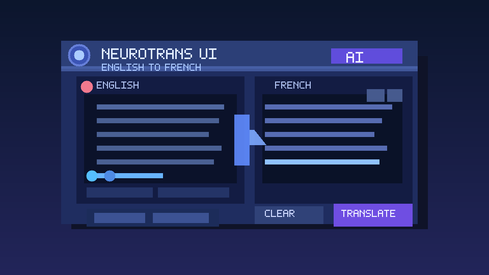

## English–French Neural Machine Translation

<p align="center">
  <table>
    <tr>
      <td align="center">
        <br>
        <b>NLP</b>
      </td>
      <td align="center">
        <br>
        <b>Machine Translation</b>
      </td>
      <td align="center">
        <br>
        <b>Logo SGU</b>
      </td>
    </tr>
  </table>
</p>

Seq2Seq máy dịch Anh–Pháp xây dựng bằng PyTorch + TorchText, với pipeline huấn luyện/evaluate đầy đủ, checkpoint tốt nhất và hàm `translate()` sẵn sàng cho việc chấm tự động.


---

## 1. Features nổi bật
- ✅ **Encoder–Decoder LSTM** hai tầng (EMB_DIM=256, HID_DIM=512) với dropout, teacher forcing và gradient clipping để ổn định.
- ✅ **Dữ liệu chuẩn Multi30k**: tokenizer spaCy, giới hạn vocab, DataLoader tự padding + sort để dùng `pack_padded_sequence`.
- ✅ **Train loop giàu tiện ích**: log loss/PPL, early stopping, lưu `best_model.pth`, vẽ `loss_curve.png`, tính BLEU trên test.
- ✅ **Inference 1 dòng** thông qua `inference.translate(sentence)` với cơ chế cache model.
- ✅ **Cấu hình tập trung** ở `config.py` giúp thử nghiệm nhanh trên GPU/CPU hoặc dữ liệu riêng.

---

## 2. Kiến trúc tổng quan
### 2.1 Mô hình
- `Encoder`: embedding + LSTM nhiều tầng, trả về context `(hidden, cell)`.
- `Decoder`: nhận token trước (teacher forcing hoặc output model), sinh phân phối vocab qua linear layer cuối.
- `Seq2Seq`: ghép encoder/decoder, khởi tạo input `<sos>` và chạy đến hết `trg_len`.

### 2.2 Luồng xử lý
1. **Preprocess**: đọc `.en/.fr`, tokenize, thêm token đặc biệt, numericalize và lưu vào `TranslationDataset`.
2. **Batching**: `collate_fn` pad sequence, sort theo độ dài giảm dần và chuyển tensor lên `config.DEVICE`.
3. **Training**: `train_eval.py` gọi `train_one_epoch` + `evaluate`, áp dụng early stopping sau `EARLY_STOPPING_PATIENCE` epoch không cải thiện.
4. **Checkpoint & Metrics**: lưu `state_dict` + vocab; BLEU tính bằng `nltk.translate.sentence_bleu` với smoothing method4.

---

## 3. Dataset & Chuẩn bị dữ liệu
| Bước | Mô tả |
| --- | --- |
| 1. Tải Multi30k | Clone hoặc tải bộ Task 1 (EN↔FR) từ https://github.com/multi30k/dataset. |
| 2. Giải nén | Đặt file `.gz` vào `multi30k-dataset/data/task1/raw`. |
| 3. Tạo `.en/.fr` | Chạy `python prepare_multi30k_en_fr_task1.py` để giải nén sang `data/multi30k_en_fr`. |
| 4. Điều chỉnh đường dẫn | Nếu lưu nơi khác, sửa `DATA_ROOT` trong `config.py`. |

Script chọn bộ test Flickr 2016 (1k câu). Bạn có thể thay file đầu vào miễn vẫn giữ cặp câu song song để pipeline hoạt động.

---

## 4. Thiết lập môi trường
```bash
python -m venv .venv && source .venv/bin/activate    # hoặc conda
pip install -r requirements.txt
```
- `requirements.txt` đã trỏ tới wheel `en_core_web_sm` và `fr_core_news_sm`. Nếu pip không tự cài hãy chạy:
  ```bash
  python -m spacy download en_core_web_sm
  python -m spacy download fr_core_news_sm
  ```
- NLTK `punkt` được tải tự động ở lần chạy đầu.

---

## 5. Huấn luyện & Đánh giá
```bash
python train_eval.py
```
Bạn sẽ nhận được:
- Log thiết bị sử dụng (GPU/CPU) theo `config.DEVICE`.
- Bảng train/val loss + perplexity mỗi epoch.
- `best_model.pth` khi val loss giảm.
- `loss_curve.png` và BLEU trung bình 100 câu test đầu khi kết thúc train.

Ví dụ log:
```
===== Epoch 3/15 =====
Epoch: 03 | Time: 1m 12s
    Train Loss: 2.451 | PPL: 11.600
    Val   Loss: 2.210 | PPL: 9.116
=> Lưu best_model.pth (model tốt nhất hiện tại)
```

---

## 6. Suy luận
### 6.1 CLI nhanh
```bash
python inference.py
```

### 6.2 Tích hợp trong code
```python
from inference import translate
print(translate("A man is riding a bicycle on the street."))
```
Hàm `translate()` load checkpoint lần đầu và cache lại để xử lý nhiều câu nhanh hơn. Điều chỉnh `MAX_LEN_GENERATE` trong `config.py` nếu muốn câu dài hơn.

---

## 7. Cấu trúc thư mục
| Path | Nội dung |
| --- | --- |
| `config.py` | Toàn bộ hyper-parameters, đường dẫn dữ liệu, device. |
| `data.py` | Tokenizer spaCy, build vocab, `TranslationDataset`, DataLoader. |
| `model.py` | Định nghĩa `Encoder`, `Decoder`, `Seq2Seq`. |
| `train_eval.py` | Vòng lặp train/val/test, checkpoint, BLEU, plot. |
| `inference.py` | Load model + hàm `translate()` để nộp bài/demo. |
| `prepare_multi30k_en_fr_task1.py` | Giải nén file `.gz` Multi30k sang `.en/.fr`. |
| `data/` | Nơi chứa dữ liệu sau khi giải nén. |
| `img/` | Đặt hình minh họa cho README/báo cáo (`@img`). |
| `loss_curve.png`, `best_model.pth` | Artifact tạo sau huấn luyện. |

---

## 8. Tùy chỉnh & Cấu hình
- **Hyper-parameters**: chỉnh trực tiếp trong `config.py` (embedding, hidden dim, dropout, learning rate, batch size, teacher forcing ratio, gradient clip…).
- **Vocab**: tăng `MAX_VOCAB_SIZE` nếu có tài nguyên, nhưng luôn giữ `SPECIAL_TOKENS`.
- **Thiết bị**: ép dùng GPU bằng `DEVICE = torch.device("cuda")` hoặc để script auto chọn.
- **Dữ liệu mới**: thay `DATA_ROOT`, giữ format `.en/.fr` cho train/val/test.

---

## 9. Artifact đầu ra
| File | Ý nghĩa |
| --- | --- |
| `best_model.pth` | `state_dict` + `src_vocab`, `trg_vocab`, `pad_idx` để load inference. |
| `loss_curve.png` | Biểu đồ Train/Val loss để chèn báo cáo hoặc README. |
| `data/multi30k_en_fr` | Folder chứa các file `.en/.fr` đã giải nén. |

---

## 10. Troubleshooting
- **Thiếu spaCy model** → chạy lại hai lệnh `python -m spacy download ...`.
- **RuntimeError về PackedSequence** → chắc chắn dùng torchtext >= 0.18 và không shuffle batch test (đã xử lý trong code).
- **CUDA Out of Memory** → giảm `BATCH_SIZE`, `HID_DIM` hoặc số layer.
- **BLEU thấp** → tăng số epoch, giảm dropout, mở rộng vocab hoặc thử attention.

---

## 11. Roadmap / Ý tưởng mở rộng
1. Thêm Attention (Luong/Bahdanau) để cải thiện chất lượng.
2. Tích hợp beam search, nucleus sampling hoặc diverse decoding.
3. Huấn luyện lại với Transformer hoặc bổ sung pretrained embeddings.


---

## 12. Cách chạy Web

Ứng dụng web Flask (`app.py`) bọc trực tiếp hàm `translate()` để demo dịch Anh → Pháp với giao diện tại `templates/index.html` và CSS ở `static/style.css`.

### 12.1 Khởi động server
```bash
cd "NLP PROJECT"                     # hoặc đường dẫn repo của bạn
source .venv/bin/activate            # tùy chọn
python app.py                        # chạy Flask (host=0.0.0.0, port=5000)
```
- Lần chạy đầu tiên app sẽ load `best_model.pth` và cache model nên CLI báo “Model loaded successfully!” trước khi mở cổng.
- Mở trình duyệt tại http://127.0.0.1:5000 để sử dụng UI và gửi câu cần dịch.

### 12.2 Gọi API JSON
Endpoint `/translate` nhận JSON `{ "text": "..." }` và trả về kết quả:
```bash
curl -X POST http://127.0.0.1:5000/translate \
     -H "Content-Type: application/json" \
     -d '{"text": "A man is riding a bicycle on the street."}'
```
Response ví dụ:
```json
{
  "success": true,
  "source": "A man is riding a bicycle on the street.",
  "translation": "Un homme fait du vélo dans la rue."
}
```

### 12.3 Minh họa giao diện
<p align="center">
  
</p>
